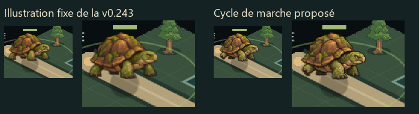
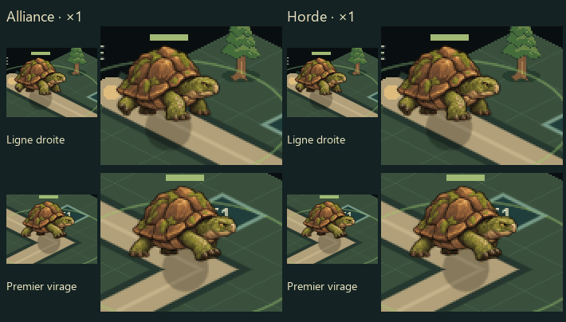
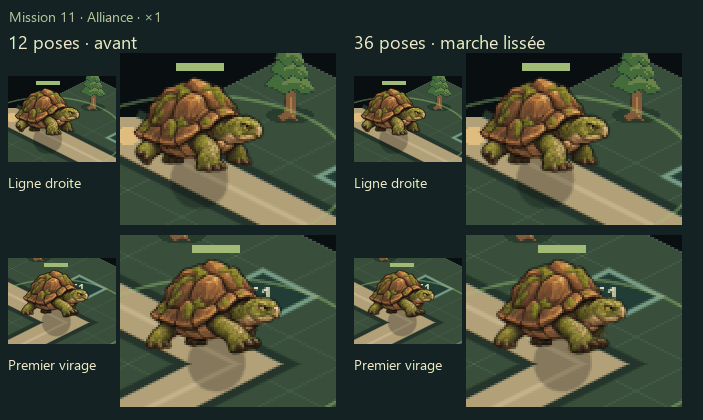
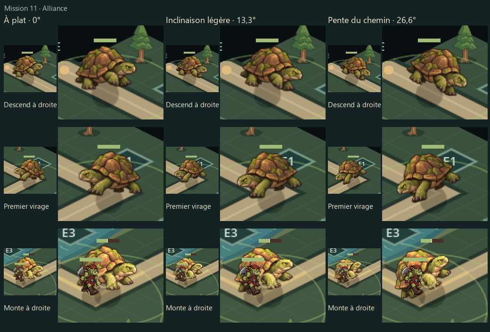

# Tortue gardienne des berges · Premier cycle de marche

Proposition du 23 novembre 2026. La tortue soulève et pose ses pattes à tour de rôle. Sa tête accompagne les appuis et la carapace conserve son volume de rocher moussu. Les douze poses complètes ont été dessinées avec le générateur d’images à partir du sprite actuel. La planche a ensuite été réduite image par image à 96 × 72 pour adoucir les contours à taille de jeu. La hauteur et l’ancrage ont été réglés en comparaison directe avec l’illustration fixe.

## Essai en combat

Mission 11, vague 2, avec l’Alliance et la Horde sur une copie de la v0.243. Les captures à ×1 et ×2 couvrent la première portion droite et le premier virage. La tortue garde la même cadence de pas par distance parcourue. Les douze poses ont été observées et la phase reste continue au passage de l’angle. Le jeu utilise une vue de trois quarts avec miroir selon le côté. Le virage change donc de vue d’une image à l’autre. Une vue de dos et un geste de virage demanderaient des poses dédiées.

[Voir l’essai à ×2](essais/tortue_marche_v0243/Tortue_en_combat_x2.gif).

## Contrôles et fichiers

146 captures, dont deux avec l’illustration fixe. À temps de combat égal, les poses et les positions consignées correspondent à ×1 et ×2 dans les deux factions. Le validateur relève zéro problème sur 65 dossiers. Quatre suites ciblées passent. `test_bank_guardian.gd` (699), `test_guardian_inspection.gd` (36), `test_enemy_walk.gd` (1 278) et `test_animation_library.gd` (206).

Les fichiers [animation.json](essais/tortue_marche_v0243/animation.json) et [walk.png](essais/tortue_marche_v0243/walk.png) forment la planche `enemy.neutral.turtle/walk`. Mode par distance, foulée de 13 px à l’échelle du cadre, ancre (50, 69) et hauteur de cadre 39. La proposition attend l’avis du porteur. La copie d’essai utilise les mêmes règles de combat et de protection que la v0.243.

## Cycle lissé sur retour du porteur

Le 23 novembre 2026, le porteur a demandé une marche plus fluide. Deux images intermédiaires par transition portent le cycle à 36 images, avec le même réglage de foulée. Les douze dessins sont conservés au pixel près. Les intermédiaires suivent le déplacement des contours dans les deux sens, y compris entre le dernier dessin et le premier.

- Alliance [×2](essais/tortue_marche_souple_v0243/Tortue_alliance_x2_avant_apres.gif)
- Horde [×1](essais/tortue_marche_souple_v0243/Tortue_horde_x1_avant_apres.gif) · [×2](essais/tortue_marche_souple_v0243/Tortue_horde_x2_avant_apres.gif)

Sur la mission 11, vague 2, 576 captures comparent les deux cycles à temps de combat égal. Les deux versions utilisent les mêmes positions. Le changement d’orientation au virage reste celui de la version à 12 images. Sur un cadre fixe à taille native, la plus grande différence moyenne entre deux images voisines du cycle passe de 10,65 à 4,37 niveaux de couleur sur 255, fermeture de boucle comprise. Le validateur relève zéro problème sur 65 dossiers, avec un avertissement pour l’image de référence de l’atelier. Les quatre suites ciblées repassent, soit 2 219 contrôles.

Le lot à 36 images remplace la première proposition et attend l’avis du porteur. [Planche](essais/tortue_marche_souple_v0243/walk.png) · [Description](essais/tortue_marche_souple_v0243/animation.json).

## Comparatif entre 36 et 48 images par foulée

Le 23 novembre 2026, le porteur a demandé un essai à une cadence supérieure. Les deux planches partent des douze mêmes dessins et parcourent la même foulée en environ 0,75 s à vitesse ×1. La cadence de la planche passe d’environ 48 à 64 IPS. Les 624 captures de la mission 11, vague 2, sont prises à intervalles équivalents à un rendu de 60 IPS. Les vidéos à 60 IPS font défiler le même extrait quatre fois.

- Alliance [×1](essais/tortue_marche_48_v0243/Tortue_alliance_x1_36_vs_48.mp4) · [×2](essais/tortue_marche_48_v0243/Tortue_alliance_x2_36_vs_48.mp4)
- Horde [×1](essais/tortue_marche_48_v0243/Tortue_horde_x1_36_vs_48.mp4) · [×2](essais/tortue_marche_48_v0243/Tortue_horde_x2_36_vs_48.mp4)

Après avoir isolé le sprite à taille native sur la portion droite, les deux factions donnent les mêmes résultats. L’écart entre images représente une moyenne de niveaux de couleur par pixel sur 255.

| Mesure | 36 images | 48 images |
| --- | ---: | ---: |
| Pose répétée à ×1, sur 51 transitions à l’écran | 10 | 0 |
| Écart au 95e percentile à ×1 | 4,18 | 3,34 |
| Plus grand écart à ×1 | 4,37 | 4,46 |
| Pose répétée à ×2, sur 25 transitions à l’écran | 0 | 0 |
| Écart au 95e percentile à ×2 | 7,36 | 5,95 |
| Plus grand écart à ×2 | 7,70 | 6,20 |

La version à 48 images réduit les poses répétées à ×1 et les écarts les plus fréquents aux deux vitesses. Le plus grand écart à ×1 reste du même ordre. Le pivot reste instantané dans les deux versions. L’essai vérifie la présentation du mouvement sur une grille à 60 IPS. Les performances d’affichage d’une partie jouée en direct restent hors de ce contrôle.

La planche de 48 images est la proposition retenue pour avis. [Planche](essais/tortue_marche_48_v0243/walk.png) · [Description](essais/tortue_marche_48_v0243/animation.json). Validateur à zéro problème sur 65 dossiers, avec deux avertissements liés aux planches de référence de la copie, et 2 219 contrôles réussis dans quatre suites ciblées.

## Marche reconstruite autour des appuis au sol

Le porteur a jugé que le cycle de 48 images manquait encore de fluidité. Le nouveau cycle part du dessin fixe déjà en jeu. Chaque patte a une trajectoire continue et décalée. Durant l’appui, son recul relatif compense l’avance de la tortue sur la route. La patte se soulève et revient sous le corps en suivant une trajectoire arrondie. La tête et la carapace accompagnent les transferts de poids par de petits mouvements. Le cycle garde 48 images par foulée et une foulée de 13 px.

- Alliance [×1](essais/tortue_appuis_v0243/Tortue_alliance_x1_appuis.mp4) · [×2](essais/tortue_appuis_v0243/Tortue_alliance_x2_appuis.mp4)
- Horde [×1](essais/tortue_appuis_v0243/Tortue_horde_x1_appuis.mp4) · [×2](essais/tortue_appuis_v0243/Tortue_horde_x2_appuis.mp4)

Sur les 936 captures comparées de la mission 11, les positions et la durée de la foulée correspondent image par image. Le suivi par motif autour des coussinets des deux pattes proches, sur la partie centrale des appuis, mesure au plus 0,16 pixel d’écart par axe par rapport à un appui idéal. Sur un cadre fixe à taille native, l’écart moyen au 95e percentile entre deux images voisines passe de 1,82 à 1,19 niveaux de couleur sur 255 pour la planche principale. L’écart sur le raccord de boucle passe de 1,90 à 0,75. Le virage emploie le changement de sens existant. La planche `walk_up` adapte l’appui à la diagonale montante.

Les fichiers [animation.json](essais/tortue_appuis_v0243/animation.json), [walk.png](essais/tortue_appuis_v0243/walk.png) et [walk_up.png](essais/tortue_appuis_v0243/walk_up.png) constituent la nouvelle proposition. Cadres 116 × 90, ancre (59, 77) et hauteur 45. Le validateur relève zéro problème sur 65 dossiers avec des avertissements pour les trois planches archivées dans la copie d’essai. Les quatre suites passent, soit 2 219 vérifications. La proposition attend l’avis du porteur.

## Démarche d’origine avec 60 images par foulée

Le porteur préfère la démarche dessinée des premiers essais et souhaite y ajouter des images intermédiaires. Les douze dessins clés sont repris à l’identique, avec quatre intermédiaires entre chacun. Les 60 images suivent les mêmes positions clés. Le cadrage reprend 96 × 72, l’ancre (50, 69) et la hauteur 39. La foulée de 13 px dure toujours environ 0,75 s à ×1. L’essai de démarche reconstruite autour des appuis reste archivé.

- Alliance, échantillonnage à 60 IPS [×1](essais/tortue_ancienne_60_v0243/Tortue_alliance_x1_48_vs_60.mp4) · [×2](essais/tortue_ancienne_60_v0243/Tortue_alliance_x2_48_vs_60.mp4)
- Horde, échantillonnage à 60 IPS [×1](essais/tortue_ancienne_60_v0243/Tortue_horde_x1_48_vs_60.mp4) · [×2](essais/tortue_ancienne_60_v0243/Tortue_horde_x2_48_vs_60.mp4)
- [Alliance à ×1, échantillonnage à 120 IPS](essais/tortue_ancienne_60_v0243/Tortue_alliance_x1_48_vs_60_120ips.mp4)

Le plus grand écart moyen par pixel entre deux images consécutives de la planche à taille native, raccord de boucle compris, passe de 3,37 à 2,74 niveaux de couleur sur 255. À 60 IPS, les deux versions changent de pose à chaque image sur l’extrait en ligne droite. L’échantillonnage saute parfois des poses et le 95e percentile des écarts augmente avec la planche de 60 à ×1 (3,34 à 4,43) comme à ×2 (5,95 à 6,78). À 120 IPS, côté Alliance à ×1, les transitions qui réaffichent la même pose passent de 49 à 35 sur 103. La cadence de rendu est échantillonnée par l’atelier et sa tenue en partie dépend de la machine.

1 040 captures sur la mission 11, dont 624 sur la grille à 60 IPS et 416 à 120 IPS. Les positions de jeu correspondent entre versions. Le validateur relève zéro problème sur 65 dossiers dans la copie, avec les avertissements des anciennes planches de comparaison. Quatre suites ciblées au vert, 2 219 contrôles.

Le porteur a accueilli favorablement la démarche à 60 images (lot d5ed8d75) et a demandé un essai d’inclinaison. [Planche](essais/tortue_ancienne_60_v0243/walk.png) · [Description](essais/tortue_ancienne_60_v0243/animation.json).

## Inclinaison suivant le chemin

Sur copie v0.244, la planche de 60 images est comparée à plat, avec la moitié de l’angle projeté du chemin (13,3°), puis avec l’angle complet (26,6°). La rotation est rigide autour de l’ancre au sol. Le signe suit le sens du trajet et le miroir horizontal. L’ombre et la jauge restent ancrées sur le plateau. Le changement de sens garde son timing instantané.

- [Comparatif vidéo côté Alliance](essais/tortue_inclinaison_v0244/Tortue_alliance_angles.mp4)
- [Comparatif vidéo côté Horde](essais/tortue_inclinaison_v0244/Tortue_horde_angles.mp4)

L’inclinaison de 13,3° rend le sens du trajet lisible tout en gardant une posture proche de la démarche d’origine. À 26,6°, les pattes se retrouvent fortement décalées par rapport au sol et la tortue semble basculer. Le porteur a retenu l’angle de 13,3° le 23 novembre 2026 avec la marche à 60 images. Les trois variantes sont uniquement dans l’atelier et le moteur de la branche artistique reste identique.

La mission 11, vague 2, donne 864 captures de combat sur trois portions, avec la descente à droite, le virage vers la gauche et la montée à droite, dans les deux factions. La position, la phase de marche et les PV correspondent entre variantes. Le validateur donne zéro problème sur 65 dossiers. Les quatre suites ciblées passent, soit 2 219 contrôles.
