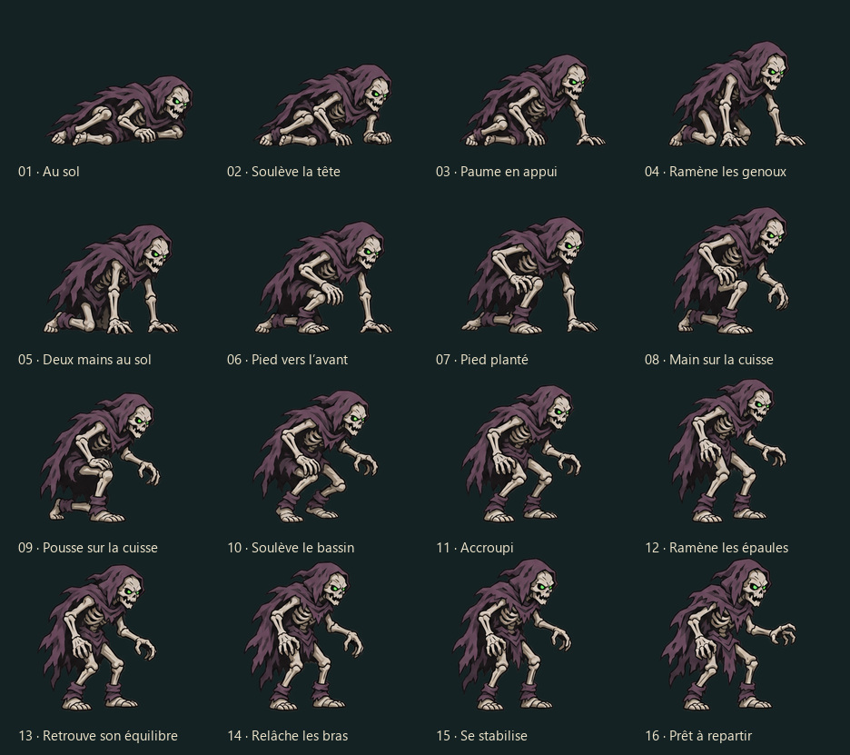

# Revenant · Relève dessinée image par image

Le 23 novembre 2026, le porteur a demandé de reprendre la gestuelle de la relève. La nouvelle planche compte seize dessins complets sur 0,72 s. Le Revenant se tourne vers le sol, s’appuie sur ses paumes, ramène un pied, pousse sur sa cuisse puis retrouve sa posture de marche. La cape et la cage thoracique changent de silhouette avec les appuis. L’illustration du Revenant en jeu a servi de référence au générateur d’images pour les seize poses, assemblées à une échelle commune avec des repères d’appui.

## Essai sur la mission 191

La planche a été essayée en ligne droite et dans un virage sur une copie de la v0.243, avec les deux factions. Le coup fatal déclenche la règle habituelle de relève à mi-vie. Pour chaque essai, les captures couvrent les seize poses et quatre images de reprise de marche. Les GIF juxtaposent la taille native et un agrandissement ×2.

- [En combat côté Alliance](essais/releve_dessinee_v0243/Releve_en_combat_alliance.gif)
- [En combat côté Horde](essais/releve_dessinee_v0243/Releve_en_combat_horde.gif)

Quatre séquences de 21 captures. Le validateur relève zéro problème sur 64 dossiers. Les suites `test_revenant.gd` (44), `test_enemy_walk.gd` (1 278) et `test_animation_library.gd` (205) passent.

## Cadence et arrêt du temps de combat

L’atelier a utilisé le traitement normal du combat à ×1 et ×2, en lui fournissant des pas de temps contrôlés. À temps de combat égal, les 21 cadrages du Revenant correspondent pixel pour pixel dans chaque faction. En arrêtant l’avancement de l’atelier au milieu de la relève, le temps de combat et les pixels du Revenant sont restés stables pendant 310 à 389 ms aux deux vitesses, puis la séquence a repris. Ce contrôle utilise un arrêt d’atelier. Le choix de vitesse du combat comporte ×1, ×2 et ×10.

## Intégration après validation

[Planche](essais/releve_dessinee_v0243/rise.png) de seize images de 372 × 354 et [description](essais/releve_dessinee_v0243/rise.json) de l’état `rise`. Remplacer la planche et l’entrée `rise` dans `prototype/assets/animations/enemy.neutral.revenant/`. Hauteur de cadre, point d’appui (170, 327), durée de relève de 0,72 s et marche conservés. L’essai reprend le raccord de position de la v0.243. Le porteur a validé la planche le 23 novembre 2026 (lot cfb41268).
