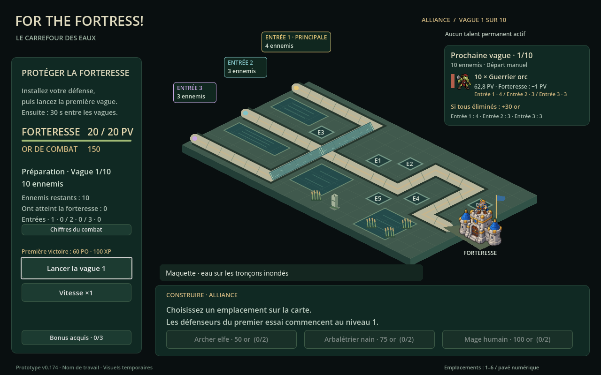

# Tronçons inondés — proposition d’habillage du 11 novembre 2026

Une eau bleu-vert laisse entrevoir les pierres de la chaussée. Les reflets courts indiquent la surface de l’eau et un liseré plus clair marque la transition avec la route sèche. Les bassins décoratifs gardent leur aspect et les remous au pied de **Gueule-de-Vase** restent réservés à sa régénération. [Maquette avec la créature](essais/eaux_inondees/Mission_51_avec_Gueule_de_Vase.png)

Le dossier `design/essais/eaux_inondees/` contient dix calques PNG transparents, un par carte des missions 51 à 60, et un [fichier de repères](essais/eaux_inondees/Reperes.json). Chaque calque suit les distances `from` et `to` des tronçons `flooded`, avec découpe aux angles réels du chemin. Les sections physiquement communes ne reçoivent qu’un seul calque d’eau. Les coordonnées de dessin, le cadre de référence de 1 280 × 800 et les données des routes ayant servi à préparer chaque calque sont consignés dans les repères.

| Carte | Contrôle de composition |
| --- | --- |
| [51 — Les Eaux Mortes](essais/eaux_inondees/Mission_51_eau.png) | Deux zones inondées avec transitions en milieu de chaussée. |
| [55 — Le Delta des Noyés](essais/eaux_inondees/Mission_55_eau.png) | Trois entrées et une zone inondée commune après la jonction. |
| [58 — Le Carrefour des Eaux](essais/eaux_inondees/Mission_58_eau.png) | Deux branches humides. Le trajet du milieu reste sec avant et après le croisement visuel. |
| [60 — Le Cœur du Marais](essais/eaux_inondees/Mission_60_eau.png) | Zones humides de branches et long parcours commun, y compris plusieurs virages. |

Les huit maquettes ont été examinées dans les deux factions, à partir de captures Godot prises sur l’écran de droite et avec un profil isolé. Le repère bleu a été retiré uniquement sur le fond de capture, sans partie jouée. Pour les dix calques, le contrôle a confirmé la présence d’eau au milieu de chaque segment inondé et l’absence de recouvrement des six emplacements de défense par les pixels visibles. Sur la mission 58, des points de contrôle confirment que les branches humides et les portions sèches du trajet central sont distinctes. Au croisement, la régénération dépend toujours de la route suivie par l’unité.

**Retour du porteur, 11 novembre 2026.** L’habillage lui paraît bien sur la maquette. Le prochain contrôle porte sur le rendu en combat.

Pour un essai intégré, dessiner le calque à sa position sur le plateau au-dessus de la chaussée et de ses joints, sous les emplacements, les unités et les annonces. Utiliser les données `flooded` du modèle pour les règles. Si la géométrie d’une carte évolue ou diffère dans un rapport ancien, utiliser le repère calculé par le jeu jusqu’à ce qu’un calque corresponde à cette géométrie. Commencer par les missions 51 et 58 et vérifier la lisibilité au passage d’un Gueule-de-Vase et dans les prévisions d’entrée. La maquette reste à valider en jeu. Les bassins décoratifs et l’aperçu de mission restent des chantiers séparés.

## Contrôle en combat et extension sur la v0.178

- **Les Eaux Mortes (51), vague 2.** Le premier passage montre la chaussée sèche, l’entrée dans l’eau avec remontée des PV et remous, puis le retour au sec avec disparition de l’effet. Les trois états ont été vus dans les deux factions. [Transitions en combat](essais/eaux_v0178/Mission_51_combat.jpg)
- **Le Carrefour des Eaux (58), départ direct en vague 8.** Gueule-de-Vase blessée récupère des PV sur la branche haute. Sur la route centrale, ses PV restent stables au croisement et ses pieds restent sans remous, même quand la projection recouvre une portion bleue des branches latérales. Sur la branche basse, la créature observée était déjà à pleine vie. Les branches cessent d’être inondées à leur jonction. [Croisement en combat](essais/eaux_v0178/Mission_58_combat.jpg)
- **Surlignage de route.** En préparation, le survol de chacune des trois entrées déclenche son tracé. L’ordre de dessin actuel garde le surlignage au-dessus du calque. Le tracé reste lisible sur l’eau et le franchissement du croisement se suit à l’écran. [Comparatif du survol](essais/eaux_v0178/Mission_58_survol.jpg)
- **Extension.** Les huit autres PNG (52–57 et 59–60) sont dans `prototype/assets/decor/eaux/` avec leurs repères dans `decor.json`. Chaque carte a été inspectée à la vague 2 dans les deux factions. [Missions 52–55](essais/eaux_v0178/Extension_52_55.jpg) · [Missions 56, 57, 59 et 60](essais/eaux_v0178/Extension_56_60.jpg)

La géométrie actuelle des dix cartes correspond aux routes et aux intervalles déclarés. Le validateur d’animations relève zéro problème. Les deux suites ciblées décor et chapitre des marais passent (16 130 contrôles Godot, 17 tests Python). L’aperçu de mission et les bassins décoratifs restent des sujets distincts.
