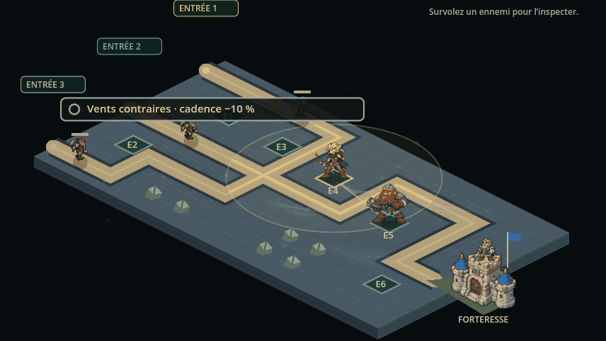

# Vents contraires · Rafales au sol

Proposition du 22 novembre 2026 pour le chapitre 4. Des traînées gris bleuté rasent les ardoises de droite à gauche avec des grains de poussière. Les rafales s’atténuent aux bords du plateau et passent derrière les silhouettes. Un premier essai trop léger à taille native a été renforcé. La cadence reste réduite de 10 % pendant la mission.

## Intégration

La planche `effect.headwinds/rafales.png` contient 60 images transparentes de 256 × 140 à 24 images/s. La boucle dure 2,50 s. La description emploie `idle` en mode `time`. Sur la copie d’essai, la planche est étirée sur le rectangle des quatre coins projetés du plateau et dessinée avant les éléments du décor et les unités, en combat. Sa phase suit `model.elapsed`. Le bandeau reste visible en préparation. Les traînées provisoires servent de repli. L’activation du visuel se fait dans `_draw_headwinds` par Claude Code après retour du porteur.

## Contrôles

Vingt captures des missions 31 à 40 dans les deux factions sur une copie de la v0.240, à la troisième vague. L’extrait de la mission 36 déroule 60 images capturées sur 2,50 s de combat. La boucle de la planche contient 60 images distinctes et sa jonction est dans la plage des variations entre images adjacentes. La lecture à ×1 et ×2 suit le temps de combat. Une pause de l’arbre de scènes a figé le temps de combat et l’index de la planche à chaque vitesse dans l’atelier. Le validateur passe sur 63 dossiers. Les suites de chargement d’animation (204 contrôles), de Vents contraires (2 553) et du bandeau d’affixe (4 113) passent.

Le bandeau de Vents contraires surplombe la chaussée et des ennemis pendant la vague 3 sur les missions 36 et 39 dans la v0.240. Les étiquettes d’entrée restent lisibles. Le nouveau placement du bandeau a par ailleurs été vérifié sur les missions 174 et 180, dans les deux factions à l’avertissement et sous la Brume marine. Le chevauchement des étiquettes y est corrigé.

- [Rendu comparé sur trois cartes](essais/vents_contraires/Vents_contraires_comparatif.jpg)
- [Bandeau au-dessus du trajet sur 36 et 39](essais/vents_contraires/Bandeau_sur_la_route_36_39.jpg)
- [Vérification de la correction aux missions 174 et 180](essais/vents_contraires/Brume_marine_bandeau_v0240.jpg)
