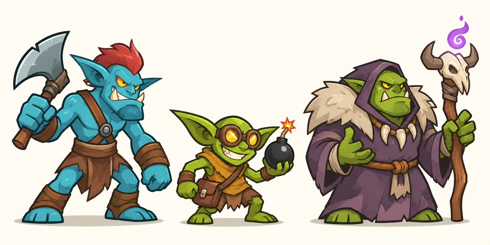

# Direction cartoon — planche Horde 001

27 octobre 2026. Complément aux [orientations de présentation](../Orientation_presentation_2026-10-26.md).

## Décisions de style confirmées

Le porteur du projet a fourni une illustration de référence puis demandé de continuer dans cette direction : cartoon minimaliste, formes compactes, grandes têtes et mains, armes lisibles, contours épais, couleurs franches et ombres simples. Les personnages du jeu doivent conserver leur race et leur rôle. La référence sert à définir un langage visuel ; elle n’est pas un asset du jeu.

## Référence artistique validée

Le 27 octobre 2026, le porteur du projet a explicitement retenu cette planche : « j'aime vraiment bien ce que tu as proposé, on va partir sur ce style ». Elle devient la référence de style pour les prochains personnages et leur adaptation au plateau.



Cette première planche originale présente, de gauche à droite :

- Lanceur de haches troll : peau turquoise, grandes oreilles, crête rouge, hache.
- Sapeur gobelin : petite taille, peau verte, lunettes, sacoche et bombe.
- Chaman orc : corps massif, robe violette, fourrure claire et bâton à totem.

Le style de la planche est validé. Le détail des ombres, les proportions et la lisibilité des assets à la taille du plateau restent à vérifier pendant leur adaptation. Ce document ne fixe pas de nouvelles statistiques, de nouvel équipement achetable ou de nouvelle capacité.

## État d’intégration

PNG de concept sur fond clair, conservé comme référence artistique validée. Ce n’est pas une feuille de sprites d’animation et ce fichier n’est pas consommé par le prototype. La planche elle-même reste une référence ; ses trois personnages disposent désormais d’[assets transparents individuels intégrés dans la v0.60](../Assets_Horde_v060.md).

Les premiers assets individuels dans ce style sont intégrés dans la v0.60 ; leur lisibilité sera affinée avec les retours du joueur. Les personnages des autres factions devront partager ce langage de formes tout en conservant leurs races, rôles et équipements. Le GDD principal conserve sa version v0.14 ; For the Fortress! demeure un nom de travail dont la disponibilité juridique est à confirmer.

## Provenance et consigne de génération

Outil intégré `image_gen`, utilisé via la compétence imagegen ; aucune API CLI externe utilisée. Référence de style : illustration fournie par le porteur du projet dans le chat. Génération d’une planche nouvelle ; aucun retrait de filigrane ni modification de la référence. Fond clair opaque volontaire pour cette planche de concept.

Consigne exacte :

```text
Use case: stylized-concept. Asset type: ONE landscape visual-development concept board for the French fantasy tower-defense game For the Fortress!, a working title. Input image 1 is STYLE REFERENCE ONLY, not an edit target: use its chunky compact cartoon language, thick dark outlines, large readable shapes, simple two-tone cel shadows and expressive faces. Create THREE wholly original full-body characters arranged side by side with generous spacing on a plain warm off-white background, consistent front three-quarter view, feet on the same baseline. No scenery, no UI, no decorative border, no labels or text. This is a coherent minimal game-character concept sheet, not realistic painted splash art. Very limited details, 4-6 main flat colors per character, broad clean highlights, no texture noise, no tiny studs, no intricate armor, no gradients, crisp vector-like illustrated finish. Strong silhouettes readable at very small map scale. Left: a turquoise-blue TROLL AXE THROWER, relatively tall and lean but with oversized head and hands, long pointed ears, two small tusks, short warm-red crest, simple brown leather clothing, holding one clearly readable broad throwing axe, no shield, no gun. Middle: a smaller lime-green GOBLIN SAPPER, very large pointed ears, oversized round goggles, simple ochre/brown outfit, one small satchel and one unmistakable round black bomb with a short fuse, mischievous confident face, no axe, no firearm. Right: a stocky moss-green ORC SHAMAN, broad jaw, small tusks, simple muted-purple robe and light fur shoulder collar, holding a wooden staff topped by a simple bone totem with one small purple magical accent; no axe, no warrior sword, no huge headdress. Differentiate each race and role through shape and equipment, not just color. Match the reference's friendly-aggressive expressive cartoon clarity while using new faces, new poses and new costume designs. Do not reproduce its exact orc, pose, ponytail, enormous double-bladed axe or costume. No logos, no stock-site marks, no watermarks, no signatures, no copied characters. Keep all characters and their equipment fully visible and clearly separated. Original concept artwork, intended as a first art-direction proposal rather than final animation sprites.
```
